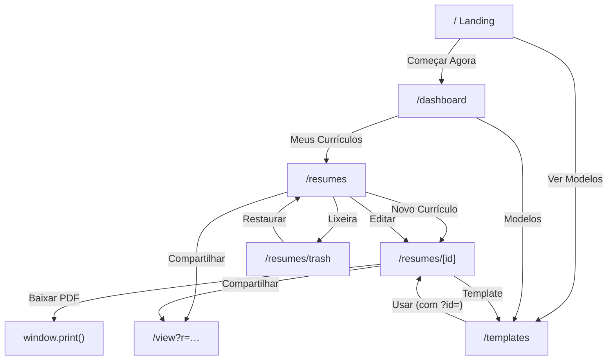

# 🗺️ Mapeamento de Telas — HireWerk

> Todas as telas são SPA client-side (Nuxt 4, `ssr: false`). Dados 100% em `localStorage` (prefixo `hirewerk:`), sem backend. Layout único em `app/layouts/default.vue`: header fixo com navegação (Dashboard, Currículos, Templates, Lixeira), tema claro/escuro, footer desktop e bottom nav no mobile.

---

## Visão geral das rotas

| Rota | Arquivo | Função |
|------|---------|--------|
| `/` | `pages/index.vue` | Landing pública (hero + benefícios) |
| `/dashboard` | `pages/dashboard.vue` | Hub pós-login com métricas e atalhos |
| `/resumes` | `pages/resumes/index.vue` | Lista de currículos ativos (grid de cards) |
| `/resumes/[id]` | `pages/resumes/[id].vue` | Editor completo + preview A4 |
| `/resumes/trash` | `pages/resumes/trash.vue` | Soft-deleted; restaurar ou excluir de vez |
| `/templates` | `pages/templates.vue` | Escolher template (via editor ou exploração) |
| `/view?r=…` | `pages/view.vue` | Visualizador read-only de link compartilhado |

---

## 1. `/` — Landing (`index.vue`)

**Estados:** estática; nenhuma leitura de storage.

- Badge "100% Client-Side & Gratuito" com animação fade-in
- Hero com título + subtítulo; CTAs: **Começar Agora** → `/dashboard`, **Ver Modelos** → `/templates`
- Três cards de benefícios (Velocidade, Privacidade, Design)
- Tema aplicado por script inline no `<head>` antes da primeira pintura (sem flash)

## 2. `/dashboard` — Dashboard (`dashboard.vue`)

**Fonte de dados:** `store.index` (localStorage `hirewerk:resumes:index`).

- **Loading:** spinner até `store.ready` (hidratação do storage)
- **Métricas:** cards com total ativo e total na lixeira (`computed` sobre o índice)
- **Atalhos:** dois links grandes → `/resumes` e `/templates`
- Nenhuma mutação; apenas leitura e navegação

## 3. `/resumes` — Lista (`resumes/index.vue`)

**Fonte de dados:** `store.index` filtrando `deletedAt === null`.

- **Loading:** spinner até `store.ready`
- **Vazio:** estado dedicado ("Nenhum currículo ainda") com CTA "Criar meu primeiro currículo"
- **Card de currículo** (hover revela ações):
  - **Compartilhar** → gera link `/view?r=<base64url do doc>` (Web Share API; fallback: copia para clipboard + toast)
  - **Duplicar** → `store.duplicateResume(id)` (copia doc com novo UUID, título + " (cópia)", `version: 1`, sem snapshots)
  - **Lixeira** → `store.softDelete(id)` (marca `deletedAt`, mantém doc + snapshots) + toast
  - **Editar Currículo** → navega para `/resumes/<id>`
- **Novo Currículo** (header) → `store.createResume()` (id novo, título "Novo currículo", template `classic`, `data: {}`) e navega direto ao editor

## 4. `/resumes/[id]` — Editor (`resumes/[id].vue`)

Tela mais complexa. **Fonte de dados:** doc completo (`hirewerk:resume:<id>`) lido e validado com Zod.

- **Estados de entrada:**
  - spinner até `store.ready`
  - `!resume` → tela "Currículo não encontrado" com link de volta
  - doc com `deletedAt` → erro 404 (`createError`)
- **Toolbar superior** (classe `.toolbar`, escondida no print):
  - Título editável inline (Input estilizado sem borda)
  - Badge de status: "Salvando..." (pulsa) ↔ "Salvo"
  - **Undo/Redo** com Tooltip; habilitados conforme `canUndoNow`/`canRedoNow` (refs atualizadas a cada save/undo/redo)
  - **Baixar PDF** → `window.print()` com CSS `@media print` (esconde chrome do app, mantém só a página A4)
  - **JSON** → download do doc via Blob
  - **Compartilhar** → mesmo fluxo de link da lista
  - **Template** → `/templates?id=<id>`
- **Atalhos globais:** Ctrl+S (salvar), Ctrl+Z (undo), Ctrl+Y / Ctrl+Shift+Z (redo)
- **Mobile:** abas Editar/Visualizar (uma coluna por vez); desktop: editor + preview lado a lado
- **Editor (coluna esquerda):** 4 seções em cards colapsáveis — Dados Pessoais (nome, título, resumo), Experiência (lista dinâmica: cargo, empresa, período, descrição), Educação (curso, instituição), Habilidades (lista de strings). Botões "Adicionar" e remoção por item.
- **Preview (coluna direita):** página A4 (`A4Paper`) com o template do currículo; **zoom 50–100%** (slider, `transform: scale`, sticky); atualização em tempo real enquanto digita
- **Autosave:** qualquer input dispara `handleUpdate` → debounce de 1s → `store.updateResume`
  - snapshot do estado anterior vai para o histórico (máx. 30, FIFO)
  - pilha de redo persistida em `hirewerk:resume:<id>:future` (sobrevive a refresh)
  - qualquer nova edição depois de um undo limpa o redo (ramificação)
- **Undo/Redo:** restaura estado anterior/seguinte do doc, reescreve snapshots, sincroniza o índice

## 5. `/resumes/trash` — Lixeira (`resumes/trash.vue`)

**Fonte de dados:** `store.index` filtrando `deletedAt !== null`.

- **Loading:** spinner até `store.ready`
- **Vazio:** estado dedicado ("Lixeira vazia") com link para `/resumes`
- **Lista em linhas** com título + data de remoção (formatada `pt-BR`):
  - **Restaurar** → `store.restore(id)` (`deletedAt: null`)
  - **Excluir** → AlertDialog de confirmação → `store.hardDelete(id)` (remove doc + snapshots + entrada do índice; irreversível)
- **Esvaziar Lixeira** → AlertDialog → `store.emptyTrash()` (hardDelete em todos)
- Ambos os AlertDialogs mostram contagem/título e desabilitam botões durante `isLoading`

## 6. `/templates` — Modelos (`templates.vue`)

**Fonte de dados:** lista de templates (`hirewerk:templates`, seed com `classic`, `minimal`, `modern`).

- **Loading:** card skeleton com `animate-pulse`
- **Vazio:** "Nenhum template disponível"
- **Card por template:** preview **real renderizado** (componente do template com dados de amostra "Maria Silva" dentro de `A4Paper` escalado a 62%) + nome + descrição + botão **Usar**
- **Usar** (`applyTemplate`):
  - sem `?id=` na URL → erro "Sem contexto do currículo" (a página precisa vir do editor)
  - doc não existe → erro "Currículo não encontrado"
  - sucesso → `store.updateResume({ ...resume, templateId })` (passa pelo versionamento normal) + navega de volta ao editor

## 7. `/view?r=…` — Visualizador (`view.vue`)

Tela pública sem dependência do store; usada por quem recebe o link.

- **Decode:** `decodeShareLink` converte base64url → JSON → valida com `ResumeDocSchema`; inválido/ausente → estado "Link inválido" com link para `/`
- **Sucesso:** título (nome do currículo), página A4 com o template correspondente ao `templateId` do doc, footer "Criado com HireWerk"
- Tudo em `no-print`: ao imprimir a partir daqui, sai só a página A4
- SEO: `useSeoMeta` com nome do portador no título da aba

---

## Fluxos entre telas

## Estrutura de dados no localStorage

| Chave | Conteúdo |
|-------|----------|
| `hirewerk:meta` | Versão do schema + datas (controle de migrações) |
| `hirewerk:resumes:index` | Array resumido: `{id, title, templateId, updatedAt, deletedAt}` |
| `hirewerk:resume:<id>` | Doc completo: dados, versão, template, timestamps |
| `hirewerk:resume:<id>:versions` | Últimos 30 snapshots `{version, data, createdAt}` (FIFO) |
| `hirewerk:resume:<id>:future` | Pilha de redo (persistida; sobrevive a refresh) |
| `hirewerk:templates` | Seed dos 3 templates |
| `hirewerk-theme` | `"light"` ou `"dark"` (fora do prefixo, usado pelo script anti-FOUC) |
