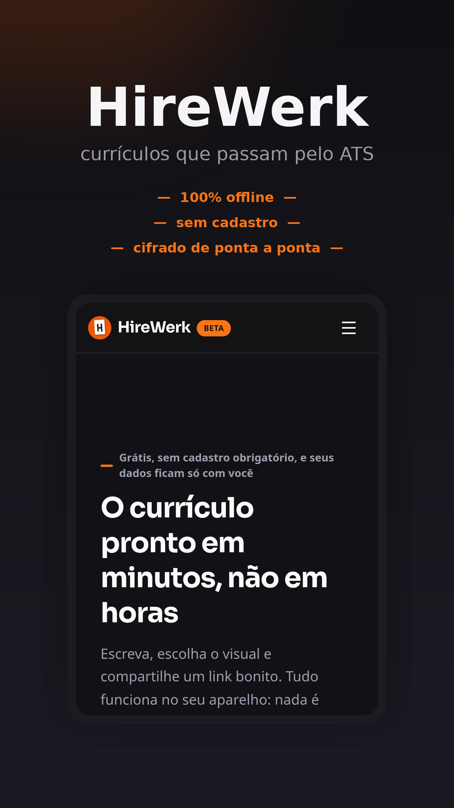

# HireWerk 💼

> **Construtor de currículos offline-first** com Nuxt 4, Vue 3 e design premium. Sync opcional criptografado de ponta a ponta.

---

[](https://hirewerk.pages.dev)
[]()
[]()
[]()

**HireWerk** é um editor de currículos moderno que prioriza a privacidade e a rapidez. Por padrão, seus dados ficam no seu navegador (`localStorage`) — nada sai do aparelho. Opcionalmente, sincronize entre aparelhos com criptografia de ponta a ponta: o servidor guarda apenas blobs que ele mesmo não consegue ler.

**Em produção:** [hirewerk.pages.dev](https://hirewerk.pages.dev) · [Política de privacidade](https://hirewerk.pages.dev/privacy)

---

## ✨ Destaques

- 🎨 **Design premium**: glassmorphism, micro-interações, dark mode nativo.
- 📱 **Responsivo de verdade**: editor em abas no mobile, min-h-11 em todos os toques, auditoria axe-core no CI.
- 🔒 **Privacidade por padrão**: sem banco, sem nuvem, sem telemetria no modo offline. Sync opt-in com AES-GCM (chave derivada da passphrase, PBKDF2 100k).
- ⚡ **Preview em tempo real**: A4/Letter, zoom, fullscreen, layout lado/embaixo.
- 💾 **Versionamento**: snapshots nomeados, auto-snapshot diário, **diff estruturado campo a campo** entre versões, undo/redo global e por campo.
- 🎯 **Compatibilidade com a vaga**: score ATS local com histórico persistido, sugestões de tailoring aplicáveis em um clique e descrição da vaga salva no currículo.
- ✉️ **Carta de apresentação**: documento próprio, gerado a partir do currículo e da vaga, com três tons de escrita — tudo local.
- 📋 **Tracker de candidaturas**: kanban por status (quero aplicar → enviada → entrevista → proposta/recusada) com follow-ups pendentes.
- 📤 **Export completo**: PDF, PNG, DOCX, TXT, JSON, **JSON Resume (padrão aberto)**, ZIP + import de PDF, LinkedIn, backup e JSON Resume.
- 🔗 **Share avançado**: link simples, link com senha (Web Crypto), expiração, QR, link encurtado com métricas, publicação pública revogável e **Share Target com arquivo (Android)**.
- 🔐 **Criptografia no aparelho**: opcional, AES-GCM sobre o localStorage — sem a frase-senha os currículos não são legíveis nem pelo app.
- ✍️ **Revisão de escrita**: linter local (verbo fraco, bullet sem métrica, frase longa, clichê) com contagem de páginas A4 em tempo real.

## 🚀 Como rodar localmente

O projeto usa **Bun** (ou npm — o CI usa npm).

```bash
cd apps/nuxt-web
bun install
bun run dev        # http://localhost:4000

bun run generate    # build estático em .output/public
bun run typecheck   # vue-tsc, 0 erros esperados
bun run test:unit   # node --test: merge de sync, ATS, diff, linter, carta, JSON Resume
bun run test:a11y   # axe-core nas 8 rotas (requer chromium)
```

## 🛠️ Stack

- **Core**: [Nuxt 4](https://nuxt.com/) (Vue 3, SPA mode) + [Pinia](https://pinia.vuejs.org/)
- **Estilo**: [Tailwind CSS v3](https://tailwindcss.com/) + design system próprio (tokens em `app/assets/css/main.css`)
- **Validação**: [Zod v4](https://zod.dev/) (schema v2 + migrações)
- **Ícones**: [Lucide](https://lucide.dev/) via `@nuxt/icon` — bundle client-side local, zero fetch externo
- **Backend (opcional)**: [Cloudflare Workers](https://workers.cloudflare.com/) + D1 — sync E2E, métricas de links, publishing
- **Qualidade**: vue-tsc strict, axe-core no CI, GitHub Actions

## 📂 Estrutura

```text
apps/nuxt-web/
├── app/
│   ├── components/      # UI base, 5 templates de CV, resume render
│   ├── composables/     # useTheme, useI18n, useSectionOrder
│   ├── lib/
│   │   ├── storage/     # localStorage, schemas Zod, migrações
│   │   ├── versioning/  # snapshots, diff, auto-diário
│   │   ├── export/      # PDF/PNG/DOCX/TXT/ZIP/JSON, share links
│   │   ├── import/      # PDF (pdf.js), LinkedIn ZIP
│   │   ├── sync/        # F10: crypto E2E + cliente de sync
│   │   │   ├── ats.ts       # score ATS local
│   │   └── i18n.ts      # pt-BR / en-US
│   ├── pages/           # dashboard, editor, templates, settings, view, about, privacy, guide
│   └── stores/          # Pinia (resume, sync, applications)
├── worker/              # F10: Cloudflare Worker (D1) — sync, métricas, publish
└── scripts/test-a11y.mjs
```

## 🎬 Vídeo de apresentação

[](docs/media/hirewerk-vertical.mp4)

Formato vertical (1080×1920, 26 s): o app em telas reais, do editor ao tracker.
Arquivo: [`docs/media/hirewerk-vertical.mp4`](docs/media/hirewerk-vertical.mp4).

## 📚 Documentação

| Documento | Conteúdo |
|---|---|
| [docs/ARCHITECTURE.md](docs/ARCHITECTURE.md) | Camadas, fluxo de uma edição, sync, criptografia, deploy |
| [docs/DATA-MODEL.md](docs/DATA-MODEL.md) | Schemas Zod, chaves do localStorage, migrações, quota |
| [docs/DEVELOPMENT.md](docs/DEVELOPMENT.md) | Comandos, convenções (i18n, a11y, layout), testes |

Dentro do app: **[Como usar](/guide)** (`/guide`) — 11 tutoriais passo a passo + FAQ, em pt-BR e en-US.

## 📦 Deploy

**Frontend** — Cloudflare Pages:

```bash
cd apps/nuxt-web && bun run generate
bunx wrangler pages deploy .output/public --project-name hirewerk --branch main
```

**API (opcional — só para sync/métricas/publish)**:

```bash
cd apps/nuxt-web/worker
bunx wrangler d1 create hirewerk-db        # cole o id em wrangler.toml
bunx wrangler d1 migrations apply DB --remote
bunx wrangler deploy
```

Depois aponte `API_BASE` (`app/lib/storage/keys.ts`) para a URL do Worker. Sem isso, o app funciona 100% offline — a API é opt-in.

SPA fallback: `public/_redirects` (`/* → /index.html 200`).

## 🔒 Privacidade

- **Modo padrão**: 100% offline, sem telemetria, sem rastreamento.
- **Sync (opt-in)**: blobs cifrados no aparelho; o servidor não consegue lê-los. Frase-senha nunca sai do dispositivo, sem recuperação.
- **Links**: conteúdo dentro do próprio link; encurtado registra apenas contador agregado de aberturas.
- Detalhes: [página de privacidade](https://hirewerk.pages.dev/privacy) · [app/pages/privacy.vue](apps/nuxt-web/app/pages/privacy.vue)

## CI

GitHub Actions: install → typecheck → build → generate → **axe-core a11y** nas rotas geradas (falha em violação critical/serious).

---

MIT © 2026 [ens-Emilio](https://github.com/ens-Emilio)
