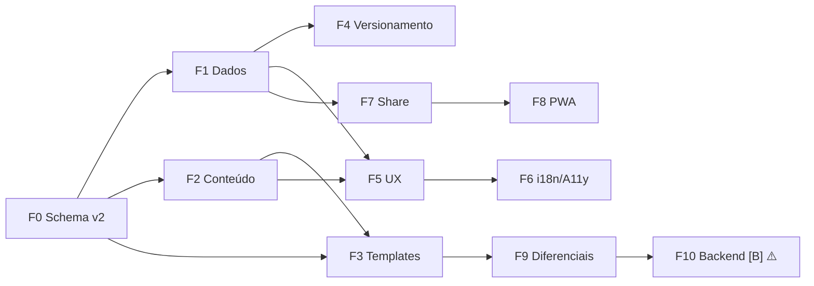

# 🚀 Roadmap — 100 Features do HireWerk

> Plano de aplicação das 100 features sugeridas, organizado por dependência técnica (não por ordem da lista original). Cada fase entrega valor sozinha. Estimativa de esforço relativo: 🟢 pequeno · 🟡 médio · 🔴 grande.
>
> **Premissa defendida:** features **[B]** (exigem backend) ficam na Fase 10, última, com decisão de produto explícita. Até lá, o app nunca envia dados a servidor algum — é o argumento de venda.

---

## Fundação: mudanças de schema que sustentam as fases seguintes

Antes de qualquer feature, um único refactor prepara o terreno (F0):

- **F0.1** — `ResumeDataSchema` sai de `record(string, any)` para schema tipado com todas as seções novas (links, projetos, certificações, idiomas com nível, voluntariado, contato múltiplo, foto)
- **F0.2** — Migração v1.0.0 → v2.0.0 (`migrations.ts` já tem o esqueleto): docs antigos ganham campos default vazios; índice ganha `tags[]`, `pinned`, `jobTitle`
- **F0.3** — Snapshots ganham `label: string | null` e `note: string | null`
- **F0.4** — Novo store `settings` (`hirewerk:settings`): tema default, densidade, idioma, formato papel, preferências de preview

---

## Fase 1 — Fundamentos de dados & import/export (29 🟢)

*Bootstrap da F0 + o ciclo de dados completo. Nada aqui muda a UI além de botões.*

| # | Feature | Ref |
|---|---------|-----|
| 1 | F0 completo (schema v2 + migração + settings store) | F0 |
| 2 | Export TXT puro do currículo | 38 |
| 3 | Export PNG (canvas client-side) | 36 |
| 4 | Export DOCX (docx.js) | 37 |
| 5 | Import JSON do app (restaura doc + snapshots) | 4, 89 |
| 6 | Backup completo: export TUDO (docs + snapshots + settings) num JSON | 88 |
| 7 | Restore completo do backup | 89 |
| 8 | "Apagar tudo" com dialog duplo de confirmação | 87 |
| 9 | Medidor de uso do localStorage na tela de configurações | 92 |
| 10 | Nome de arquivo configurável no export | 40 |
| 11 | Export múltiplo ZIP (todos os currículos, PDF+JSON) | 39 |

**Entregável:** ciclo de dados completo sem nuvem — migrar de aparelho em 2 cliques.

## Fase 2 — Editor de conteúdo rico (18 🟡)

*Novas seções e campos. UI do editor + renderização nos 3+ templates.*

| # | Feature | Ref |
|---|---------|-----|
| 12 | Campo de links (LinkedIn, GitHub, portfólio) com ícones | 5 |
| 13 | Seção Projetos | 6 |
| 14 | Seção Certificações | 7 |
| 15 | Seção Idiomas com nível (A1–C2 + barras) | 8 |
| 16 | Seção Voluntariado | 9 |
| 17 | Contato múltiplo com rótulo (pessoal/profissional) | 15 |
| 18 | Localização cidade/UF | 16 |
| 19 | Campos opcionais BR (nascimento, estado civil, pretensão) com toggle de visibilidade | 17, 18 |
| 20 | Foto opcional (Base64, com aviso ATS) | 26 |
| 21 | Duplicar item da seção | 10 |
| 22 | Reordenar itens com setas ↑↓ | 11 |
| 23 | Contador de palavras por seção | 12 |
| 24 | Validação inline de campos vazios | 13 |
| 25 | Placeholders por profissão | 14 |
| 26 | Dicionário de verbos de ação | 20 |
| 27 | Modo "sem experiência" | 19 |
| 28 | Markdown simples (negrito/itálico) no resumo, renderizado nos templates | 1 |
| 29 | Auto-complete de empresa/cargo do próprio doc | 62 |

## Fase 3 — Templates & tipografia (15 🟡)

*Novos templates + sistema de customização. Requer o schema v2 da F1.*

| # | Feature | Ref |
|---|---------|-----|
| 30 | Template Executivo (serifado, 1 coluna) | 21 |
| 31 | Template Criativo (sidebar colorida) | 22 |
| 32 | Cor de destaque personalizável (8 cores do sistema) | 23 |
| 33 | Tamanho de fonte global (3 níveis) | 24 |
| 34 | Densidade do template (0.8×/1×/1.2×) | 27 |
| 35 | Papel Letter além de A4 | 28 |
| 36 | Quebra de página manual + indicador no preview | 29 |
| 37 | Rodapé personalizado no PDF | 30 |
| 38 | Tema de ícones (nenhum/contorno/preenchido) | 31 |
| 39 | Template bilingue PT/EN | 25, 94 |
| 40 | Foto nos templates (consome campo da F2) | 26 |
| 41 | Import de template via arquivo JSON | 35 |
| 42 | Favicon/og do link compartilhado customizável | 34 |
| 43 | Preview mobile (frame de celular) | 67 |
| 44 | Modo "match vaga": destacar keywords | 33 |

## Fase 4 — Versionamento poderoso (8 🟡)

*O histórico vira produto. Constrói sobre os snapshots com label da F0.*

| # | Feature | Ref |
|---|---------|-----|
| 45 | Timeline visual de versões | 51 |
| 46 | Restaurar versão específica | 52 |
| 47 | Nomear snapshots | 53 |
| 48 | Diff de texto entre duas versões | 54 |
| 49 | Auto-snapshot diário | 55 |
| 50 | Export do histórico completo | 56 |
| 51 | Busca na lixeira | 57 |
| 52 | Recuperação de snapshot órfão | 58 |

## Fase 5 — UX do editor & navegação (16 🟡)

*Polimento de interação. Pouco risco, muito ganho percebido.*

| # | Feature | Ref |
|---|---------|-----|
| 53 | % de completude com checklist | 65 |
| 54 | Checklist de qualidade ATS | 66 |
| 55 | Salvo às HH:MM (indicador de horário) | 70 |
| 56 | beforeunload quando há mudanças não salvas | 71 |
| 57 | Renomear na lista (click no título) | 73 |
| 58 | Ordenar/filtrar lista | 74 |
| 59 | Tags por currículo + filtro | 75 |
| 60 | Favoritar (pin) | 76 |
| 61 | Tela de configurações (consome settings store da F0) | 77 |
| 62 | Tela Sobre + changelog | 78 |
| 63 | Tour de primeira visita | 79 |
| 64 | Command palette Ctrl+K | 80 |
| 65 | Fullscreen no preview | 59 |
| 66 | Layout do preview: lado/embaixo (preferência) | 60 |
| 67 | Busca e substituição global | 61 |
| 68 | Undo/redo por campo | 64 |

## Fase 6 — Acessibilidade & i18n (6 🟢)

*Base para crescer sem retrabalho. Vem depois da F5 porque novos textos precisam dos locales.*

| # | Feature | Ref |
|---|---------|-----|
| 69 | Extração de todas as strings para `locales/pt-BR.json` | 93 |
| 70 | Locale `en-US` completa | 94 |
| 71 | Skip-link para o editor | 95 |
| 72 | Toggle independente do tilt 3D | 96 |
| 73 | Auditoria completa de focus/aria (varredura nas fases 2–5) | — |
| 74 | Testes automatizados de a11y (axe-core no smoke) | — |

## Fase 7 — Compartilhamento avançado (9 🟡)

*Sem servidor: tudo que dá pra fazer no link base64url.*

| # | Feature | Ref |
|---|---------|-----|
| 75 | Link com senha (Web Crypto no payload) | 41 |
| 76 | Link com expiração (data no payload) | 42 |
| 77 | /view com botão "baixar PDF" | 43 |
| 78 | /view respeitando tema do visitante | 44 |
| 79 | QR code do link na tela de share | 45 |
| 80 | Compartilhar por e-mail (mailto com corpo) | 46 |
| 81 | Copiar como texto formatado | 47 |
| 82 | Web Share API com arquivo (canShare Blob) | 48 |
| 83 | QR do link impresso no PDF | 32 |

## Fase 8 — PWA & offline (6 🟢)

*O app já é PWA; comunicar e fortalecer.*

| # | Feature | Ref |
|---|---------|-----|
| 84 | Prompt "nova versão disponível — recarregar" | 81 |
| 85 | Força-reload pós update | 82 |
| 86 | Banner de modo offline | 83 |
| 87 | Web Share Target (receber PDF e importar) | 84 |
| 88 | Shortcuts no manifest (novo currículo, currículos) | 85 |
| 89 | Meta schema.org JobPosting nos shared links | 86 |

## Fase 9 — Diferenciais client-side (4 🔴)

*O pulo do gato. Complexas, mas sem servidor nenhum.*

| # | Feature | Ref |
|---|---------|-----|
| 90 | **Score ATS local**: cola a descrição da vaga → TF/regex compara keywords → score + sugestões | 97 |
| 91 | Multi-currículo por vaga: duplicar "para a vaga X" + diff | 99 |
| 92 | Import de PDF existente (pdf.js client-side) | 2 |
| 93 | Import de export do LinkedIn (ZIP, parse local) | 3 |

## Fase 10 — Decisão de produto: backend [B] (7 🔴)

*⚠️ Quebra a promessa "nada sai do seu aparelho". Só iniciar com decisão explícita e página de privacidade nova.*

| # | Feature | Ref |
|---|---------|-----|
| 94 | Conta opcional + sync E2E-encrypted | 100 |
| 95 | Métricas de abertura de links compartilhados | 49 |
| 96 | Hosting de currículo público (URL curta) | 50 |
| 97 | Templates da comunidade (galeria) | 35 |
| 98 | Analytics do próprio app (opt-in) | — |
| 99 | API pública de templates | — |
| 100 | Colaboração no editor (CRDT) | — |

---

## Ordem e dependências

## Regras do processo (por fase)

1. **Todo schema novo** passa pela `migrations.ts` — nunca breaking change sem migração
2. **Toda feature de UI** nasce com os 3 estados (loading/vazio/erro) e strings nos locales (a partir da F6)
3. **Todo export/import** é testado com roundtrip (exporta → importa → diff igual)
4. **Typecheck + generate + smoke visual** ao fim de cada fase, claro/escuro
5. **MAPEAMENTO-TELAS.md atualizado** por fase que adiciona tela ou fluxo
6. **Sem nova dependência** sem checar o que existe (ex.: qrcode → gerar SVG à mão é 20 linhas; zip → só com lib porque zip cru não é trivial)

## Riscos apontados

- **localStorage quota** (~5MB): foto Base64 + 30 snapshots podem estourar. Mitigação da F1: medidor de uso + aviso; compressão de foto no upload (canvas → JPEG 70%)
- **Undo/redo por campo (68)**: reescreve o sistema de snapshots. Avaliar fazer na F0 ou adiar para depois da F4 — é o único item que pode custar mais que uma fase inteira
- **WebLLM (98)**: ficou de fora do plano por custo de download (~1GB) e valor duvidoso; reavaliar sob demanda
- **F10**: qualquer item dela exige nova página de privacidade, consentimento e revisão da copy da landing ("nada sai do seu aparelho" vira "seus dados são criptografados de ponta a ponta")
